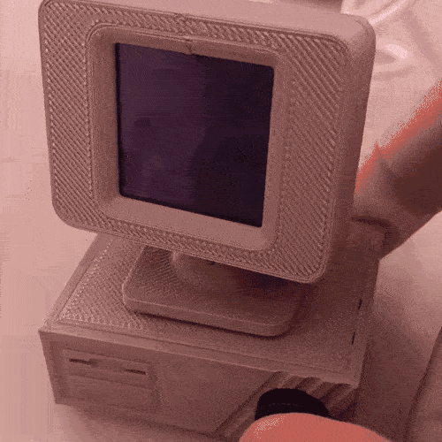
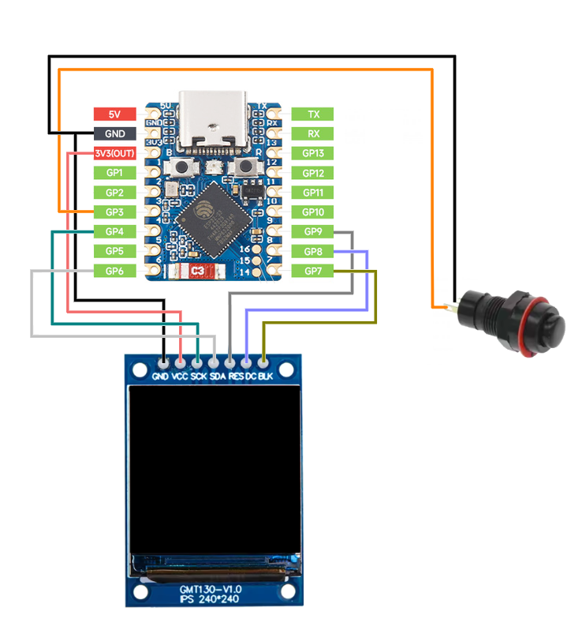
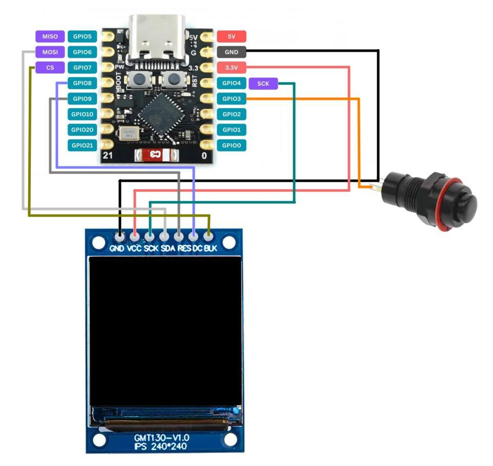

# Mini Computer examples
A few micropython examples to run on this [Mini computer](https://cults3d.com/en/3d-model/gadget/esp32-mini-vintage-computer):  

  

## Wiring:
### ESP-32 S3-Zero:

  

### ESP-32 super mini C3:

  

## Libraries:
libraries here might be outdated, their repositories are:   
https://github.com/Rumidom/Micropython_Fontlib/  
https://github.com/Rumidom/ugif

## Meme Reciever:
I also made a script that recieves images via a telegram bot, you can find that script here:  
[https://github.com/Rumidom/Meme-Receiver](https://github.com/Rumidom/Meme-Reciever/tree/main)

